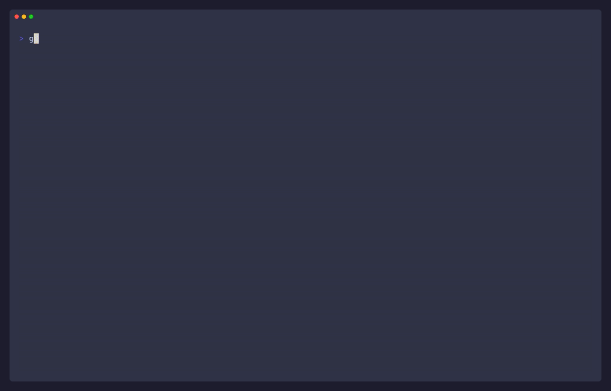
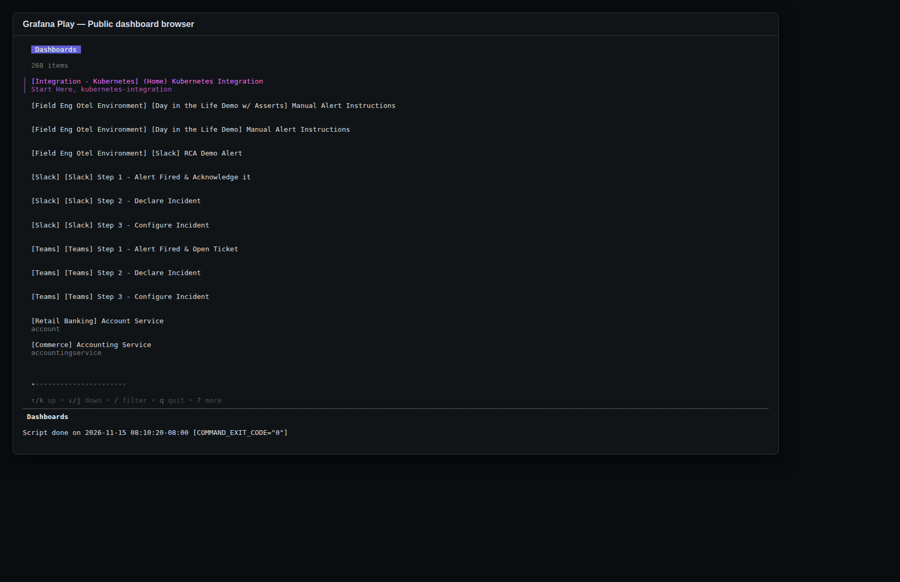
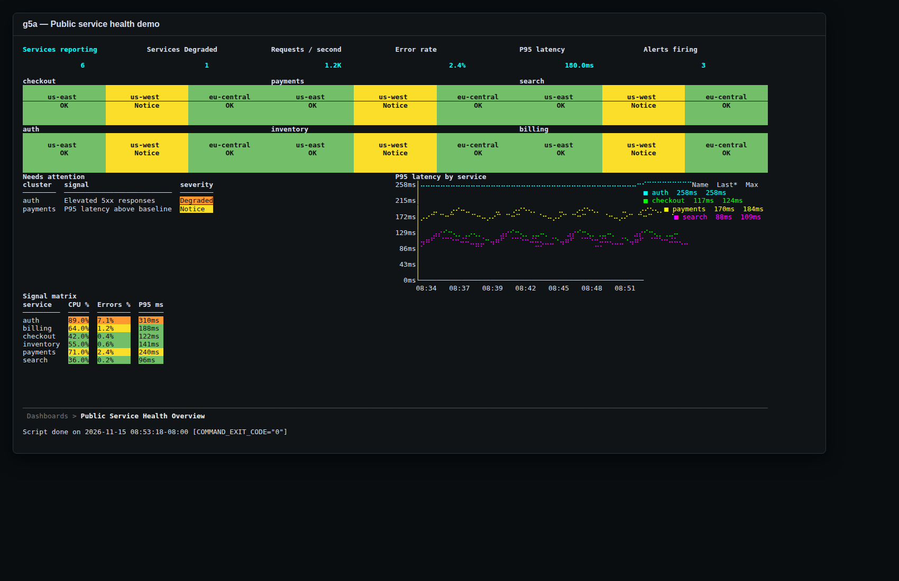
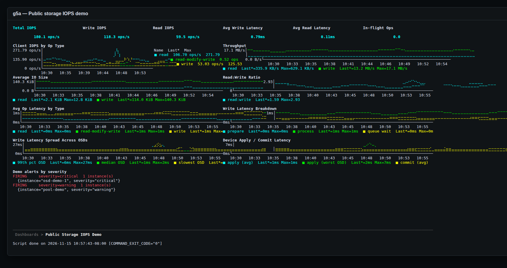
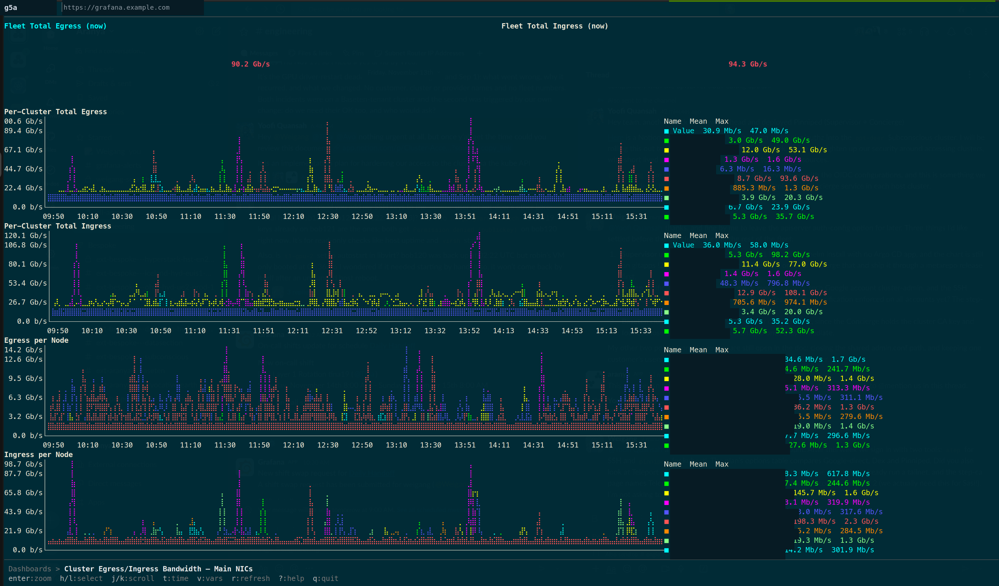

# g5a

[](https://github.com/gengwg/g5a/blob/main/LICENSE)
[](https://github.com/gengwg/g5a/actions/workflows/test.yml)

`g5a` is a read-only terminal UI for live Grafana dashboards. It connects to an existing Grafana instance, expands variables and repeated panels, queries through Grafana, and renders a responsive grid with stats, tables, and Braille time-series charts. It works over SSH and is licensed under MIT.

The name is a numeronym for **Grafana**: `g + 5 letters + a`, in the same style as `k8s` and `o11y`.








The demo and screenshots use public, synthetic, or redacted data. Private instance, cluster, and host identifiers are removed.

## Features

- Dashboard search and direct dashboard/panel URLs.
- Grafana's 24-column grid with vertical scrolling and panel zoom.
- Classic dashboards and dashboard.grafana.app v2 resources with GridLayout, RowsLayout, AutoGrid, stacked/repeated Tabs, and library-panel expansion.
- Horizontal and vertical repeated panels, repeated rows, nested RowsLayout repeats, and responsive terminal wrapping.
- Datasource, custom, constant, textbox, interval, switch, `label_values`, and `query_result` variables, including dependent query/datasource variables, escaped regex filtering, multi-select, and All, plus datasource-native `queryType` variables.
- Grafana `/api/ds/query` requests that preserve instant/range and datasource-specific target fields.
- DataFrame joins, selective label expansion, filtering, organization, reduction, type conversion, `groupingToMatrix`, `groupBy`, `formatTime`, `sortBy`, `merge`, and binary, unary, cumulative, window, and row calculations.
- Read-only alert-list panels with list/stat views, custom label grouping, current-state filters, folders, instance labels, and legacy API fallback.
- Stat, table, time-series, bar, and latitude/longitude or geohash geomap rendering with compact datasource-generated names.
- Shared field mappings, thresholds, units, decimals, overrides, datasource display names, timestamp formatting, and no-value handling.
- Bounded concurrent refresh, cancellation, stale-response protection, cached panel rendering, and per-panel errors.
- Token and basic authentication, with no request or response bodies written to logs.

See [the compatibility guide](docs/compatibility.md) for the exact supported subset and current limitations.

## Installation

### Prebuilt binaries

Download an archive from the [latest release](https://github.com/gengwg/g5a/releases/latest):

| Platform | amd64 | arm64 |
|----------|-------|-------|
| Linux | [tar.gz](https://github.com/gengwg/g5a/releases/download/g5a-v0.1.23/g5a_v0.1.23_linux_amd64.tar.gz) | [tar.gz](https://github.com/gengwg/g5a/releases/download/g5a-v0.1.23/g5a_v0.1.23_linux_arm64.tar.gz) |
| macOS | [tar.gz](https://github.com/gengwg/g5a/releases/download/g5a-v0.1.23/g5a_v0.1.23_darwin_amd64.tar.gz) | [tar.gz](https://github.com/gengwg/g5a/releases/download/g5a-v0.1.23/g5a_v0.1.23_darwin_arm64.tar.gz) |
| Windows | [zip](https://github.com/gengwg/g5a/releases/download/g5a-v0.1.23/g5a_v0.1.23_windows_amd64.zip) | [zip](https://github.com/gengwg/g5a/releases/download/g5a-v0.1.23/g5a_v0.1.23_windows_arm64.zip) |

Verify the archive against [checksums.txt](https://github.com/gengwg/g5a/releases/download/g5a-v0.1.23/checksums.txt), then extract and run it. For example, on Linux amd64:

```sh
curl -fLO https://github.com/gengwg/g5a/releases/download/g5a-v0.1.23/g5a_v0.1.23_linux_amd64.tar.gz
curl -fLO https://github.com/gengwg/g5a/releases/download/g5a-v0.1.23/checksums.txt
sha256sum -c --ignore-missing checksums.txt
tar -xzf g5a_v0.1.23_linux_amd64.tar.gz
sudo install -m 0755 g5a /usr/local/bin/g5a
hash -r
g5a --url https://play.grafana.org
```

### Go install

If Go 1.26 or newer is already installed:

```sh
go install github.com/gengwg/g5a/cmd/g5a@latest
g5a --url https://play.grafana.org
```

### Build from source

```sh
git clone https://github.com/gengwg/g5a.git
cd g5a
make build
./g5a --url https://play.grafana.org
```

The Homebrew package and release binaries at `lovromazgon/grafana-tui` are for the upstream project and do not include this repository's full dashboard-grid support.

## Usage

```sh
g5a [URL] [flags]
```

Pass the URL directly or use `--url`; the flag takes precedence over a positional URL, and `GRAFANA_URL` is used when neither is supplied.

Open a dashboard or panel directly:

```sh
g5a https://grafana.example.com/d/abc123
g5a 'https://grafana.example.com/d/abc123?viewPanel=22'
g5a --url https://grafana.example.com/d/abc123
```

### Authentication

A read-only Grafana service account is recommended. Environment variables avoid placing credentials in shell history and process listings.

```sh
export GRAFANA_URL=https://grafana.example.com
export GRAFANA_SERVICE_ACCOUNT_TOKEN=YOUR_TOKEN
g5a
```

Basic auth is also available through `GRAFANA_USERNAME` and `GRAFANA_PASSWORD`, or the corresponding CLI flags. CLI flags override environment variables.

### Flags

```text
--url         Grafana instance URL (env: GRAFANA_URL)
--token       Grafana service account token (env: GRAFANA_SERVICE_ACCOUNT_TOKEN)
--username    Grafana basic auth username (env: GRAFANA_USERNAME)
--password    Grafana basic auth password (env: GRAFANA_PASSWORD)
--debug       Enable request and response debug logs
--refresh     Auto-refresh interval (dashboard setting or 30s; 0 disables)
```

### Keybindings

Dashboard grid:

| Key | Action |
|-----|--------|
| `h` / `l` or arrows | Select the previous/next panel |
| `j` / `k` or arrows | Scroll down/up |
| `Enter` | Zoom the selected panel |
| `PgUp` / `PgDn` | Scroll one page |
| `Home` / `End` | Jump to the top/bottom |
| `t` | Change the time range |
| `v` | Change dashboard variables |
| `r` | Refresh now |
| `q` | Quit |
| `Esc` | Go back |

In the variable editor, Enter edits or applies a selection. For multi-value variables, Space toggles each value and Enter finishes editing. All is exclusive.

In a zoomed panel, `j`/`k` navigates panels, `g` opens the panel picker, and `f` filters series. `?` shows help.

## Security

The application performs read-only dashboard, datasource, query, and alert-rule API requests. It does not edit dashboards, alerting rules, silences, or datasource configuration.

Request and response bodies are not logged or included in returned error strings. Request lines are off by default; `--debug` enables method, path, status, and byte-count logs without bodies. URL userinfo is removed from transport errors. On Linux, the default log is `${XDG_CACHE_HOME:-~/.cache}/g5a/g5a.log`; the directory is created with mode `0700` and the file with mode `0600`. Other platforms use the corresponding `os.UserCacheDir` location.

Use a least-privilege read-only service account and TLS for remote Grafana instances.

## Development

```sh
make test                    # unit tests
make test-race               # race detector
make lint                    # golangci-lint
make test-integration        # real Prometheus + Grafana containers
make test-terminal           # synthetic Grafana + assertion-based PTY tests (Linux)
```

Integration tests require Docker. They create isolated temporary networks and containers for Prometheus and Grafana, then exercise variables, repeated panels, instant/range queries, joins, transformations, mappings, and renderers.

Terminal tests require Python 3, `bash`, util-linux `script`, and coreutils `timeout`. They build the real binary, drive it through a pseudo-terminal against synthetic read-only Grafana fixtures, and assert on the rendered output and captured API requests. Transcripts and captures are written to a fresh `/tmp/g5a-e2e-*` directory for each suite.

## Origin and credit

`g5a` is based on [`grafana-tui`](https://github.com/lovromazgon/grafana-tui) by **Lovro Mažgon**. The original MIT license and copyright notice are retained in [LICENSE](LICENSE), and [NOTICE](NOTICE) records the project’s origin and subsequent modifications.

This is an independent public continuation, not an upstream release. There is no affiliation with or endorsement by Grafana Labs, Lovro Mažgon, or the k8s project.

## Contributing

See [CONTRIBUTING.md](CONTRIBUTING.md). Bug reports should include the Grafana version, panel type, and a sanitized dashboard JSON/query-response fixture where possible. Do not attach credentials or private dashboard data.

## License

MIT. See [LICENSE](LICENSE).
